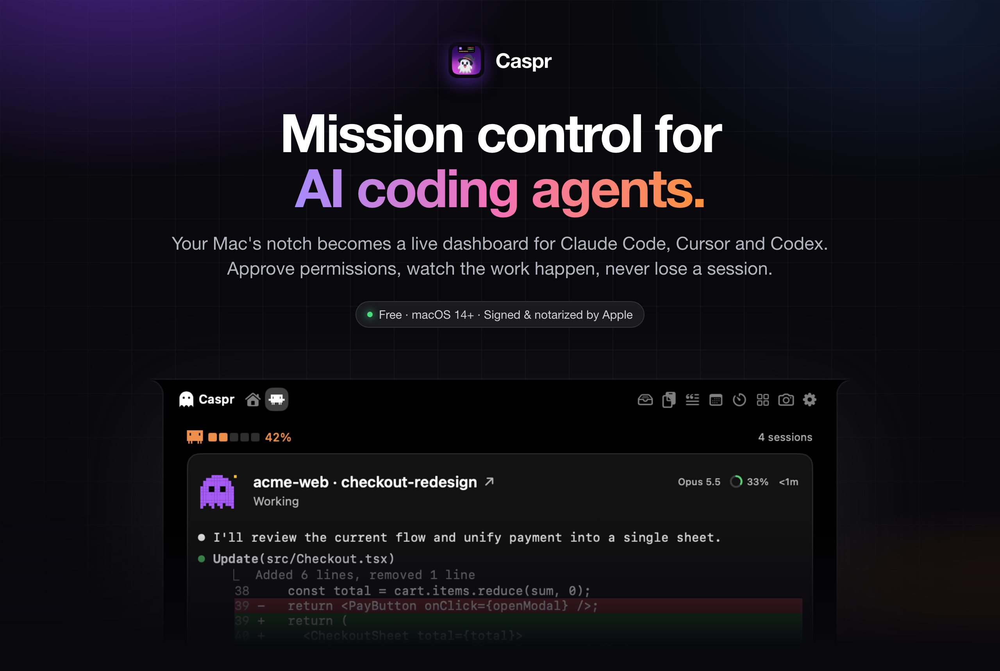
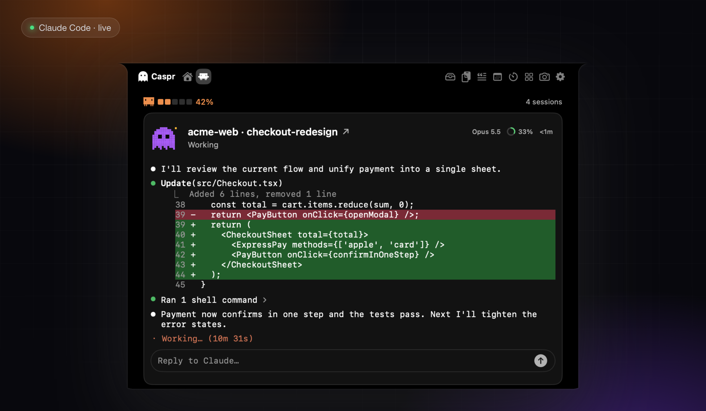
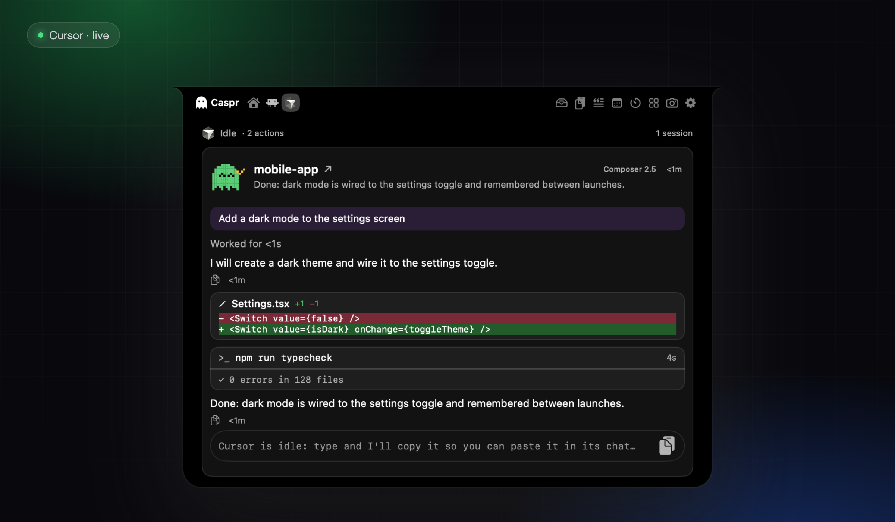
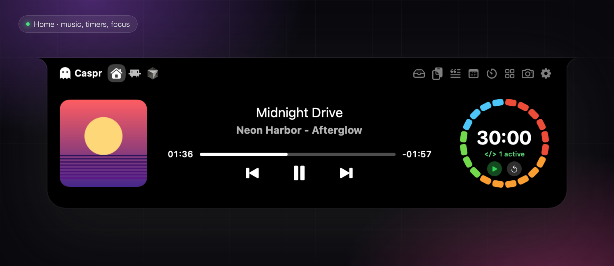
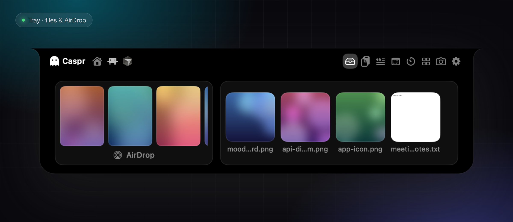

 

[English](README.md) · **Español**

---

## Tus agentes trabajan. Tú sigues concentrado.

Los agentes de IA que programan tardan minutos, piden permiso y terminan cuando estás en otra ventana. Caspr lo pone todo en el único sitio por el que ya pasa tu vista: el notch.

- **Todo de un vistazo.** Cada sesión de Claude Code, Cursor y Codex, qué está haciendo y cuánto contexto y cupo le queda.
- **Decide sin cambiar de ventana.** Aprueba o rechaza un permiso, responde una pregunta o deja una respuesta en cola desde el notch.
- **No te pierdas el momento.** El panel se abre solo cuando un agente te necesita y te llega un aviso cuando termina.
- **Un gran notch también cuando no programas.** Música, un Pomodoro para desarrolladores, temporizadores, bandeja de archivos con AirDrop reciente, calendario y más.

 

## Claude Code, en vivo

Abre cualquier sesión y mírala trabajar igual que en la terminal: ediciones con diff línea a línea, comandos y su salida, el texto de Claude y un cronómetro en vivo. Ves el cupo de tu cuenta (ventanas de 5 h y 7 d) y el contexto que usa cada sesión.

- Aprueba **Deny / Allow Once / Allow All** en permisos de herramientas y planes, o responde preguntas, sin salir de lo que haces. Nunca se aprueba nada por defecto: si Caspr está cerrado o falla, Claude Code usa su aviso normal de la terminal.
- Responde a una sesión desde el notch (Terminal, iTerm, Warp y otras terminales con una ventana por sesión).
- Salta a la terminal exacta de una sesión con un clic.

 

## Cursor y Codex, en el mismo notch

Una pestaña por herramienta y una tarjeta por sesión: mensajes, razonamiento, ediciones con diff, comandos con su salida y la respuesta final.

- **Cursor** (IDE y `cursor-agent`): aprueba o rechaza comandos de shell y MCP desde el notch, deja respuestas en cola y, si quieres, ve **cuánto te queda de tu plan de Cursor** en este ciclo de facturación.
- **Codex** (CLI y app, beta): sesiones y avisos mediante sus hooks de ciclo de vida.
- Conectar solo añade entradas claramente marcadas a la configuración de cada herramienta, tras mostrarte una vista previa y hacer una copia de seguridad. **Desconectar** quita exactamente esas entradas.

 

## Inicio: música, foco y temporizadores

Portada real y controles para Apple Music y Spotify, y un **Pomodoro para desarrolladores** cuyo anillo se va apagando mientras avanza tu sesión y muestra cuántos agentes están activos. Cambia entre varios estilos, elige cualquier duración de 1 a 240 minutos, o usa cuenta atrás y cronómetro.

 

## Bandeja, AirDrop y todo lo demás

Suelta archivos en la bandeja para tenerlos a un hover, o en AirDrop para enviarlos. Las diez fotos y vídeos más recientes que recibiste por AirDrop aparecen como un carrusel que puedes vaciar sin borrar nada de tu Mac.

También hay historial del portapapeles (solo en memoria), snippets, calendario, lanzador de apps, espejo con cámara, un HUD de volumen y brillo que sustituye al del sistema, y un notch cerrado que se adapta a lo que pasa:

 

## Instálala en 30 segundos

1. **[Descarga el último `.dmg`](https://github.com/0x-Crisbanks/Caspr/releases/latest)**. No hace falta cuenta.
2. Ábrelo y arrastra **Caspr** a **Aplicaciones**.
3. Abre Caspr y sigue la bienvenida de tres pasos. Pasa el cursor por el notch para abrir el panel, o pulsa **⌥⌘O**.

Caspr está firmada con Developer ID y notarizada por Apple, así que macOS la abre sin avisos. Se actualiza sola: cuando hay una versión nueva aparece un botón en el notch que la instala tras verificar la firma.

> **Requiere** macOS 14 Sonoma o posterior. Pensada para Macs con notch; en otros Macs dibuja uno simulado arriba (poco probado).

 

## Privada por diseño

Caspr lee tus sesiones y archivos **en tu Mac** y no los envía a ningún sitio. Las únicas conexiones son:

| Conexión | Para qué | Se puede apagar |
| :-- | :-- | :-- |
| GitHub | Buscar y descargar actualizaciones | Ajustes → Acerca de |
| URL de la portada de Spotify | La imagen que Spotify ya proporciona | n/a |
| Búsqueda pública de iTunes | Portada de canciones de Apple Music en streaming (solo título y artista) | Ajustes → General |
| cursor.com | El uso de tu plan de Cursor, con tu propia sesión de Cursor; apagado por defecto | Ajustes → Cursor |

Los permisos se piden la primera vez que usas cada función, nunca al arrancar, y todo sigue funcionando si dices que no.

 

## Preguntas frecuentes

**¿Caspr es gratis?** Sí. Descárgala y úsala.

**¿Necesito Claude Code, Cursor o Codex?** Ninguno en concreto. Caspr muestra las herramientas que tengas; la música, los temporizadores, la bandeja y lo demás funcionan solos.

**¿Caspr ve mi código?** Caspr lee localmente la actividad de las sesiones (mensajes, respuestas y llamadas a herramientas) para mostrártela. Nada sale de tu Mac salvo las conexiones de la tabla.

**¿Puede estropear mi configuración de Claude Code, Cursor o Codex?** Conectar es opcional, aditivo y reversible. Caspr muestra exactamente qué añadirá, hace una copia de seguridad antes y solo quita sus propias entradas.

**¿El código fuente está disponible?** No. Este repositorio contiene las versiones firmadas y la documentación.

**Algo falla o falta.** Abre una [incidencia](https://github.com/0x-Crisbanks/Caspr/issues) y cuéntame qué viste.

 

**[Descargar Caspr](https://github.com/0x-Crisbanks/Caspr/releases/latest)** · Hecha por [Crisbanks](https://github.com/0x-Crisbanks)

© 2026 Crisbanks. Todos los derechos reservados. Uso personal gratuito; no se permite redistribuirla ni hacer ingeniería inversa.

